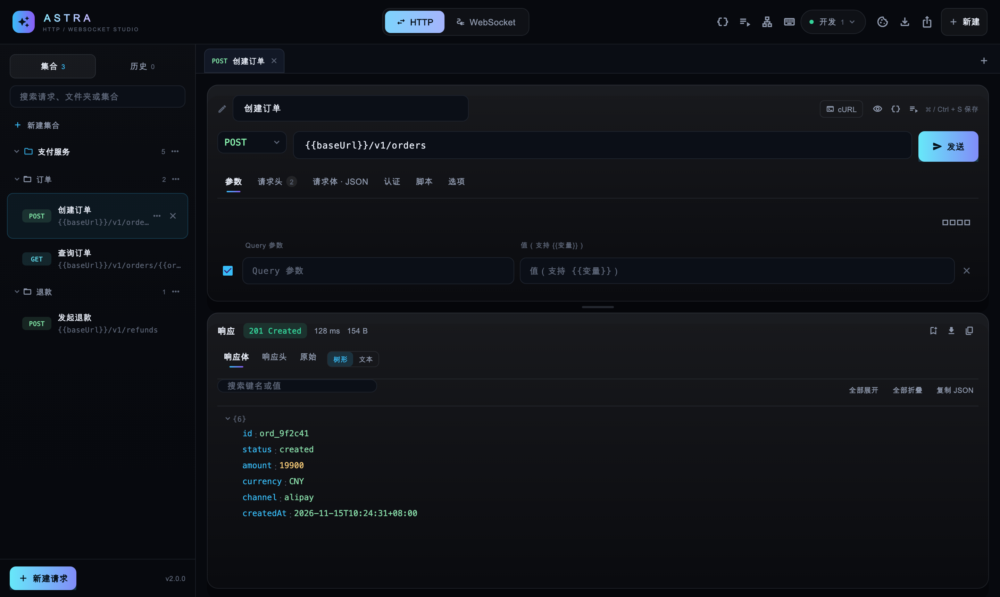
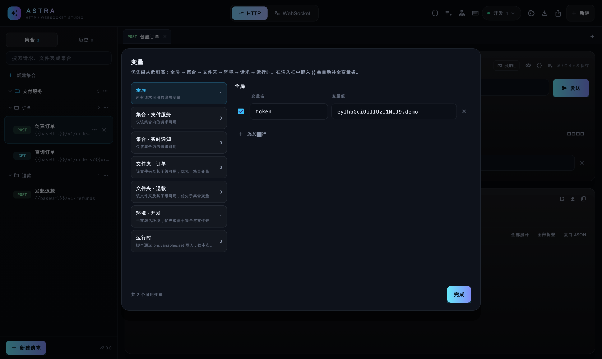

<div align="center">

# Astra

**本地优先的 API 调试客户端 · A local-first API client for macOS & Windows**

[](https://github.com/baby-1223/astra/actions/workflows/build-windows.yml)
[](https://github.com/baby-1223/astra/actions/workflows/build-macos.yml)


Postman 的轻量替代品：原生桌面体验，数据只存在你自己的电脑上，不登录、不上云。

</div>

---

## 界面预览

<div align="center">
  
</div>

<p align="center"><sub>请求编辑 + JSON 树形响应，右侧可切响应头 / Cookies / 原始报文 / 事件流 / 脚本日志</sub></p>

<table align="center">
  <tr>
    <td width="50%" align="center">
      <br>
      <sub>变量面板：分层作用域与优先级一目了然</sub>
    </td>
    <td width="50%" align="center">
      <br>
      <sub>集合运行器：批量执行、数据驱动与运行报告</sub>
    </td>
  </tr>
</table>

---

## 功能特性

### HTTP 调试
- GET / POST / PUT / PATCH / DELETE / HEAD / OPTIONS
- Params、Headers、Cookies 自动管理，重定向与证书校验开关
- 多种 Body：JSON、纯文本、`x-www-form-urlencoded`、`multipart/form-data`（含文件上传）
- 请求 / 响应可拖拽分屏，`⌘/Ctrl + Enter` 发送，`⌘/Ctrl + S` 保存

### 集合与组织
- 集合 / 多级文件夹 / 请求树，拖拽排序与跨集合移动
- 请求备注、复制、跨集合迁移、响应示例（Examples）
- 侧栏搜索过滤，集合与文件夹级备注、变量、认证

### 变量与脚本
- 全局 / 集合 / 文件夹 / 环境 / 请求级变量分层覆盖，优先级：全局 < 集合 < 文件夹 < 环境 < 请求 < 运行时
- 输入 `{{` 自动补全变量名，变量面板一键查看来源与覆盖关系
- 发送前预览最终请求（URL、Header、Body 全部解析后）
- 前置 / 后置脚本：`pm.environment`、`pm.globals`、`pm.collectionVariables`、断言、`pm.execution.setNextRequest` 请求链路编排
- 脚本编辑器带行号、自动缩进、括号自动配对、语法高亮

### 批量与自动化
- **Collection Runner**：按集合层级顺序执行，支持重复 N 次、CSV / JSON 数据驱动
- **运行报告**：通过率、失败项、耗时统计，可导出 JSON
- **定时监控**：按间隔自动运行集合并记录结果
- 请求依赖编排：脚本里 `setNextRequest` / `skipRequest` 控制执行流

### 协议与认证
- **GraphQL**（Query + Variables）、**gRPC-Web**（帧编解码）、**SSE 事件流**、**WebSocket**（消息模板库、一键重发）
- Bearer、Basic、API Key、OAuth 2.0（授权码 + PKCE、客户端凭证、密码模式，token 到期自动刷新）
- 请求 / 文件夹 / 集合级认证继承，界面显示实际生效来源

### 网络
- HTTP / SOCKS5 代理，按主机名绕过列表
- mTLS 客户端证书（P12 + 口令）、关闭 TLS 校验、自定义超时

### 响应体验
- JSON 树形浏览与键值搜索、展开 / 折叠 / 复制节点
- Cookies 面板、事件流面板、脚本断言日志
- 响应对比（行级 Diff）、响应头过滤 / 排序 / 列宽拖拽
- 大响应虚拟滚动、图片预览、二进制下载
- cURL 一键导入 / 导出
- 集合星标：点击集合行右侧星标即可置顶，搜索框右侧可切换「仅看星标」

### 稳定性与数据安全
- 工作区与草稿带 `schemaVersion`，升级后自动迁移旧文件，不会因为结构变化丢数据
- 保存失败会明确提示；每次写入轮转 `workspace.json.bak` / `.bak1`，主文件损坏时自动从备份恢复
- 未保存的请求标签实时写入 `draft.json`，崩溃、强制退出或重装后重新打开可恢复草稿
- Token、密码、API Key、OAuth Client Secret / Refresh Token 存入 macOS Keychain / Windows Credential Manager，工作区文件只保留 `secure:` 占位符
- 落盘写入串行化，避免异步保存乱序时旧数据覆盖新数据
- 大响应按行虚拟滚动，渲染上限 400 万字符并提示截断；通过「保存响应」仍可导出完整正文
- 按 `Content-Type` 与响应字节自动识别 UTF-8 / GBK / GB18030 / Big5 / ISO-8859-1；缺少 charset 的 GBK 响应会回退解码，不再乱码

### 星标与导入导出的兼容性
- 星标是本地界面偏好，保存在 `workspace.json`；Astra 自身的备份 / 导出会保留它
- Postman / Insomnia 没有星标概念：导出到这两种格式时不写入星标，从它们导入的集合一律为未星标
- 导入以追加方式创建新集合，重复导入不会覆盖已有集合，也不会清掉你本地已设置的星标
- 星标不影响请求执行、Collection Runner、变量解析与导入导出结果

---

## 本次更新（v2.1.7）

- 新增请求传输失败重试次数配置（0–10 次，仅重试连接/超时等传输错误，已返回的 4xx/5xx 不重试）
- 变量面板支持粘贴 `.env` / CSV 批量导入，并可一键复制当前作用域为 `.env`
- 新增工作区 / 草稿结构版本与自动迁移，兼容旧版数据
- 保存失败提示、双备份轮转与主文件损坏自动恢复
- 未保存草稿崩溃恢复，恢复时同步还原凭据
- 敏感凭据迁移到系统凭据库，工作区只落盘占位符
- 落盘写入串行化，避免并发保存覆盖新数据
- 大响应虚拟滚动与截断提示，完整正文仍可导出
- 非 UTF-8 响应自动解码（GBK / GB18030 / Big5 / ISO-8859-1）
- 修复 macOS 发布工作流因 GitHub arm64 机池容量不足被取消的问题，增加 Intel 机池自动重试

---

## 和 Postman 的差异

| | Astra | Postman |
|---|---|---|
| 数据位置 | 完全本地（`workspace.json`） | 默认云端账号体系 |
| 登录要求 | 无 | 需要账号 |
| 运行占用 | 原生桌面，轻量 | Electron，较重 |
| 协作与云同步 | 暂不支持（规划中） | 支持 |
| 计费 | 免费 | 免费版有限制 |

**适合谁**：后端 / 前端 / 测试日常调接口；内网或涉密环境不能把请求数据传到第三方云；想要开箱即用、不弹登录、不推订阅的桌面工具。

---

## 下载安装

前往 [Releases](https://github.com/baby-1223/astra/releases) 下载对应平台压缩包：

| 平台 | 文件 | 说明 |
|---|---|---|
| Windows 10/11 x64 | `Astra-win-x64-*.zip` | 解压后运行 `astra.exe`，需保留同目录 `data\` 与 DLL |
| macOS（Apple Silicon / Intel） | `Astra-macos-*.zip` | 解压后拖入「应用程序」 |

macOS 未签名版本首次打开需右键 → **打开**，或执行：

```bash
xattr -dr com.apple.quarantine /Applications/astra.app
```

数据保存在系统应用支持目录下的 `Astra/`（`workspace.json` 为集合与环境，`draft.json` 为未保存草稿），重装不丢失。写入时会自动保留 `workspace.json.bak` 与 `.bak1` 两份备份；敏感凭据保存在系统凭据库，不写入这两个文件。

---

## 本地开发

### 环境要求
- Flutter 3.x（Dart ≥ 3.13）
- macOS：Xcode Command Line Tools
- Windows：Visual Studio 2022 +「使用 C++ 的桌面开发」工作负载

### 运行

```bash
flutter pub get
flutter run -d macos     # 或 -d windows
```

### 测试与静态检查

```bash
flutter analyze --no-fatal-infos
flutter test
```

### 构建

```bash
# macOS
flutter build macos --release

# Windows（PowerShell）
powershell -ExecutionPolicy Bypass -File scripts\build_windows.ps1
```

Windows 脚本会自动完成环境检查、分析、测试、构建，并打包到 `dist\Astra-win-x64-<版本>-<日期>.zip`。

---

## 持续集成

| 工作流 | 触发 | 产物 |
|---|---|---|
| [Build Windows](.github/workflows/build-windows.yml) | push / PR / 手动 / `v*` 标签 | `Astra-win-x64.zip` |
| [Build macOS](.github/workflows/build-macos.yml) | 手动 / `v*` 标签 | `Astra-macos.zip`（配置 Secrets 后自动签名 + 公证；arm64 机池排队失败时自动切换 Intel 机池重试） |

推送 `v*` 标签时两端产物会一起挂到 Releases：

```bash
git tag v2.0.0
git push origin v2.0.0
```

macOS 签名公证需要配置 `MACOS_CERT_P12`、`MACOS_CERT_PASSWORD`、`KEYCHAIN_PASSWORD`、`APPLE_ID`、`APPLE_APP_PASSWORD`、`APPLE_TEAM_ID` 六个 Secrets，未配置时自动跳过签名。

---

## 技术栈

- **Flutter / Dart** 单代码库编译 macOS 与 Windows 原生应用
- **dart:io HttpClient** 实现请求、代理、mTLS、SSE；WebSocket 走 `WebSocketChannel`
- **flutter_js** 运行 `pm.*` 兼容脚本
- 纯本地 JSON 工作区存储，导入 / 导出集合与环境

---

## 路线图

- [ ] 团队协作与云同步
- [ ] OpenAPI / Postman 集合导入
- [ ] 测试断言模板与测试套件视图
- [ ] Linux 构建

---

<div align="center"><sub>Astra v2.1.7 · 用 Flutter 重写的桌面 API 调试工具</sub></div>
